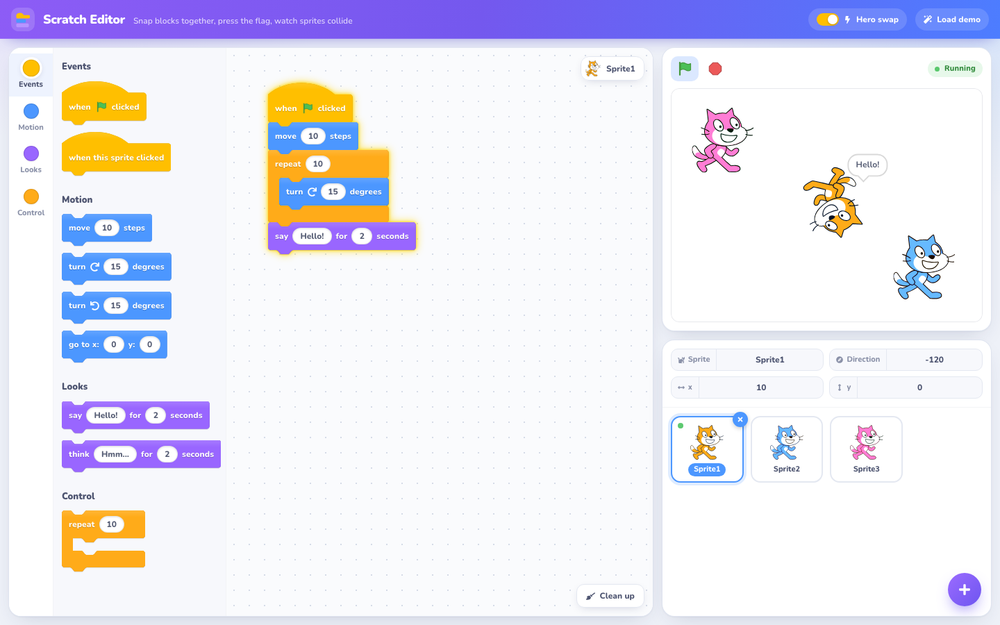
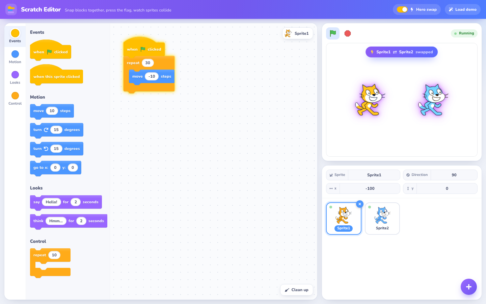

# Scratch Editor – a visual coding environment in React

A Scratch-style block editor built for the **"ReactJS – Build a visual coding environment"** challenge.
Drag blocks together to program sprites, press the **green flag** to animate them all, and watch the
**hero feature** swap two sprites' animations when they collide.

Built with **React 17 + TypeScript (strict)**, **Tailwind CSS**, webpack and Babel, with no
drag-and-drop or state-management libraries. The editor model and the animation runtime are
pure functions, covered by unit tests that run on Node's built-in test runner.



## Getting started

```bash
npm install
npm start          # http://localhost:3000
```

Other scripts:

| Command             | What it does                                   |
| ------------------- | ---------------------------------------------- |
| `npm test`          | Runs the unit tests in `src/**/*.test.ts`       |
| `npm run typecheck` | `tsc --noEmit` with `strict` on                |
| `npm run check`     | Type-check and tests together                  |
| `npm run build`     | Production bundle into `public/`               |

Requires Node 22.18+ (the tests rely on Node's built-in TypeScript type stripping).

## The challenge checklist

| Brief                                          | Where it lives                                                                                     |
| ---------------------------------------------- | -------------------------------------------------------------------------------------------------- |
| **Motion:** move, turn, go to x/y, repeat      | `Motion` and `Control` palette sections; executed in `src/engine/runtime.ts`                       |
| **Looks:** say … for … seconds, think … for … | `Looks` palette section; speech/thought bubbles rendered on the stage                              |
| **Drag-and-drop like Scratch**                 | `src/dnd/` – pointer-based, with snapping, grey drop preview, C-block nesting, delete-by-dropping |
| **Multiple sprites**                           | Sprite list under the stage: add, select, rename, position, delete; each has its own code area     |
| **Play button animates every sprite**          | The green flag runs every sprite's `when flag clicked` scripts (and loose scripts) at 30 fps       |
| **Hero feature: collision swaps animations**   | `resolveCollisions`/`swapAnimations` in `src/engine/runtime.ts`; switch and demo in the top bar    |

Only the blocks named in the brief exist, plus `when this sprite clicked` and `when flag clicked`
as the hat blocks that start scripts.

## Using the editor

1. **Build a script.** Drag `when flag clicked` from the palette into the code area, then drag
   `move 10 steps` underneath it. Blocks snap when their corners come within a few pixels, and a
   grey ghost shows where they will land. Drop blocks into the mouth of `repeat` to loop them.
   Type into the white ovals to change inputs.
   The category rail on the left jumps between Events, Motion, Looks and Control.
2. **Run it.** Press the **green flag** above the stage, or click any script to run just that one
   (it glows while it runs; click again to stop it). Clicking a palette block runs it on the
   selected sprite, as in Scratch. Hover the stage to read x/y coordinates for `go to x: y:`.
3. **Edit.** Drag a block to take it and everything below it. Drag blocks back onto the palette
   to delete them, or right-click a block for **Duplicate** / **Delete Block**. **Clean up**
   lines all scripts up in a tidy column.
4. **Add sprites.** Use the round **+** button, then select a sprite to edit its scripts. Each new
   sprite gets its own colour. Drag a script onto another sprite's tile to copy it there. Sprites
   can be dragged around the stage, and the fields above the tiles edit the selected sprite's
   name, x, y and direction. Clicking a sprite on the stage triggers its
   `when this sprite clicked` scripts.
5. The red **stop sign** ends every running script and clears speech bubbles.

### The hero feature

With **Hero swap** switched on in the top bar (it is by default), every frame the runtime checks each pair of
sprites. When two sprites *start* touching (their centres come within 80 stage units) and at
least one of them is animating, they trade animations:

- their **scripts** swap, so the code area shows each sprite's new program,
- their **running threads** swap, so the swap happens mid-animation without restarting,
- any **speech bubble** moves with the animation.

A pair swaps once per contact and only after separating can it swap again. Sprites already
overlapping when Play is pressed, or added while something runs, are left alone. The stage
announces each swap and flashes the two sprites.

Two deliberate choices: a swap also fires when only one of the two sprites is animating, so a
walking sprite that bumps into an idle one hands its program over, and swaps are persistent, so
pressing Play again after a swap runs the exchanged programs.

Press **Load demo** in the top bar to load the example from the brief: Sprite1 runs
`repeat 30 { move 10 steps }` and Sprite2 runs `repeat 30 { move -10 steps }`. They walk towards
each other, collide in the middle, swap, and walk back apart.



## How it is built

```
src/
├── blocks/catalog.ts      Block definitions: category, shape, label parts, default inputs
├── model/                 Pure data model and script-editing helpers (+ tests)
│   ├── types.ts           Block, Script, Sprite, Project, Thread, Runtime, AppState
│   ├── blocks.ts          detach / insert / delete / clone stacks, drop targets
│   └── project.ts         sprite factories, the initial project and the hero demo
├── engine/                The runtime (+ tests)
│   ├── geometry.ts        Scratch coordinate system, fencing, collision test
│   └── runtime.ts         threads, one-frame-per-step scheduler, hero swap, play/stop
├── state/
│   ├── reducer.ts         Root reducer and the Action union
│   └── store.tsx          React context + the 30 fps requestAnimationFrame loop
├── dnd/
│   ├── DragProvider.tsx   Pointer-event drag sessions, drop zones, floating ghost
│   └── hitTest.ts         Measures snap points once per drag and picks the nearest
└── components/            TopBar, Sidebar (palette + rail), MidArea (code area), Stage, SpritePanel, …
```

**State** is a single `{ project, runtime }` object owned by `useReducer`. `project` is what you
edit; `runtime` is what is running. Every reducer case is a pure function, so the whole engine,
including the hero feature, is tested without a browser (`src/engine/runtime.test.ts`). A seeded
property test (`src/state/invariants.test.ts`) also drives the reducer through tens of thousands of
random runs, drags, deletes and swaps, checking after every step that sprites stay on the stage,
ids stay unique and no thread or speech bubble is left behind.

**The runtime** gives each running script a *thread*: a stack of frames (one per nested `repeat`)
and a program counter. Each animation frame, `tick` steps every thread until it yields. Motion and
looks blocks yield once per frame, so each step is visible, and `say`/`think` wait on a timestamp.
This mirrors how Scratch's own VM schedules scripts.

**Drag and drop** uses pointer events, so it works with mouse, pen and touch. When a drag starts,
the connection points of every block on the canvas are measured once; while dragging, the nearest
point within 32 px becomes the drop target and a grey copy of the stack is rendered in place.
Dropping applies the same `applyDrop` helper the preview used, so what you see is what you get.

**Blocks** are drawn with CSS `clip-path` polygons: rounded corners, a soft notch on top that
mirrors the tab underneath, Scratch's hat curve sampled from its cubic, and C-block arms. They
stack with Scratch's puzzle-piece look without any images. Each category sets its colour and
darker edge shade through CSS variables, which drive the hairline outline, the embossed labels and
the input focus ring. A dragged stack lifts and tilts slightly around the grab point.

**Design.** The interface keeps Scratch's block colours and layout and adds a calmer shell: the
Nunito typeface, soft card surfaces, a category rail with scroll-spy, per-sprite costume tints,
Scratch's green flag and stop sign, a running indicator, a swap announcement, and drop-zone
feedback (a trash target over the palette, "Copy here" on sprite tiles). The layout adapts to
the screen: three columns on desktop, stage and sprites side by side above the editor on
tablets, and a single column on phones, where the palette becomes a horizontal strip. Keyboard
focus is always visible, and animations respect `prefers-reduced-motion`.

## Notes and trade-offs

- The brief prefers ReScript React and accepts JavaScript or TypeScript. This implementation uses
  TypeScript throughout, with `strict`, `verbatimModuleSyntax` and `erasableSyntaxOnly`, so the
  same source runs through Babel in webpack and natively in Node's test runner.
- All blocks are stored and edited as plain JSON, which keeps undo/redo or persistence easy to
  add later; neither was asked for, so neither is included.
- Collision detection is circle-based with a fixed sprite radius, which is accurate enough for the
  single cat costume and keeps the hero feature deterministic (and testable).
- A running script runs the blocks it had when it started, so edits to it take effect the next
  time it runs (Scratch applies them live). Deleting a running script stops it.
